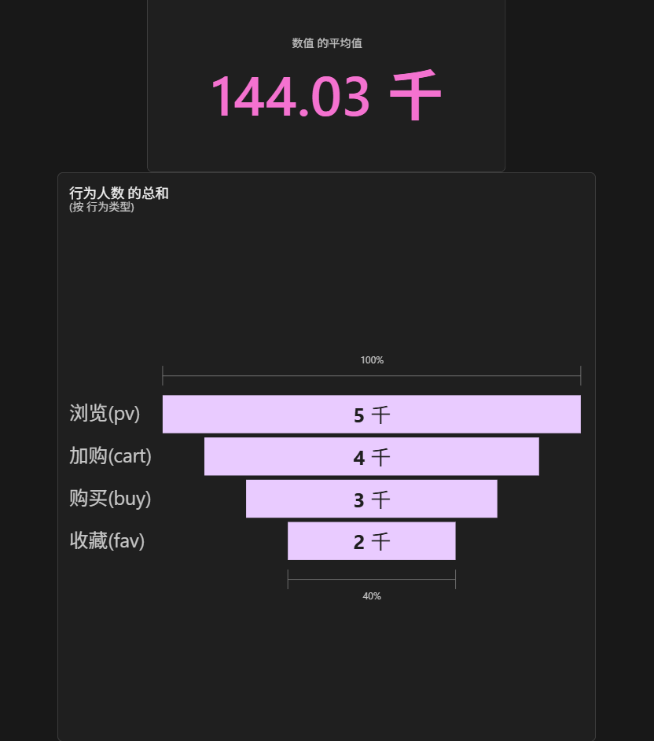
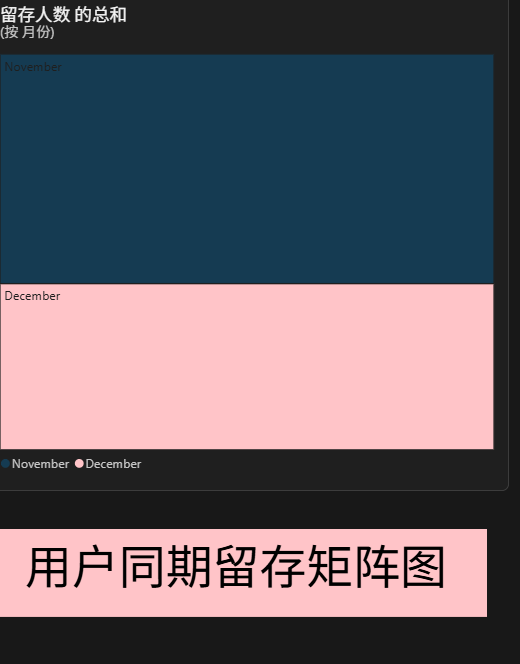
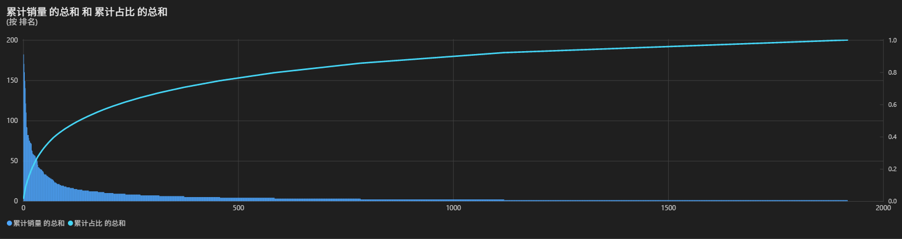
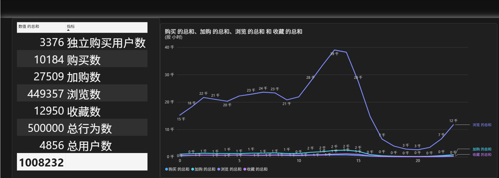

# 淘宝用户行为数据分析 🛒

基于淘宝用户行为公开数据集，对百万级用户行为记录进行数据清洗与分析。通过漏斗分析、同期群分析和帕累托分析挖掘用户行为特征。

## 📊 可视化看板

### P1 转化漏斗

### P2 同期群留存

### P3 品类帕累托

### P4 行为概览

## 📌 核心结论
- **超半数用户首月后流失**，召回机制待加强
- **品类高度集中**，前20%品类贡献71%销量
- **资源应集中投入头部品类**

## 💡 综合运营建议
- **转化提升**：针对加购未购买用户实施精准营销
- **留存提升**：建立用户召回体系，在首购后7天黄金窗口内触达
- **品类优化**：资源向头部品类倾斜，长尾品类做清仓或淘汰

## 📂 项目产出文件
| 文件名 | 说明 |
| :--- | :--- |
| `taobao_dashboard.pbix` | Power BI 交互式看板源文件 |
| `淘宝用户行为数据分析报告.pdf` | 完整分析报告 |
| `p1-funnel.png` ~ `p4-overview.png` | 看板各页面预览 |

## 🛠️ 技术栈
Python (Pandas, Matplotlib, Seaborn) · Power BI · 漏斗分析 · 同期群分析 · 帕累托分析
